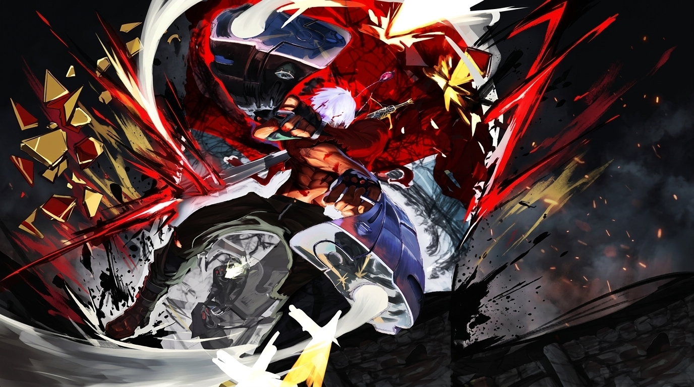

<div align="center">

  <!-- HERO BANNER -->
  

  <br/><br/>

  <!-- STYLIZED SVG TITLE -->
  

  <!-- DYNAMIC ANIMATED TYPING SUBTITLE (CINZEL FONT) -->
  <a href="https://git.io/typing-svg">
    
  </a>

  <br/><br/>

  <!-- QUICK ACTION BADGES -->
  <p>
    <a href="https://www.artstation.com/omarsami" target="_blank">
      
    </a>
    <a href="mailto:Omar.Almaqtari2003@gmail.com">
      
    </a>
    
    
  </p>

</div>

---

### 🩸 DEVIL HUNTER STATUS // HUD

```yaml
┌────────────────────────────────────────────────────────────────────────┐
│ 🩸 CODE VITALITY            : [██████████████████████████████] 100%    │
│ ⚡ DEVIL TRIGGER (Engines)   : [██████████████████████████████] READY   │
│ 🏆 STYLE RANK               : [SSS] SMOKIN' SEXY STYLE!!             │
│ 🎯 PRIMARY FOCUS            : Flutter • Hard-Surface 3D • Game Dev   │
│ 🎓 GUILD ROLE               : UI/UX Lecturer & Design Systems        │
└────────────────────────────────────────────────────────────────────────┘
