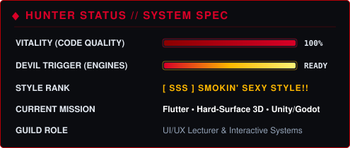
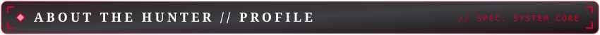
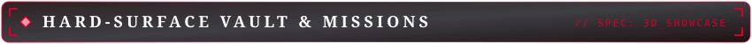
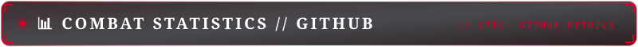

  <!-- HERO BANNER -->
  

    

  <!-- STYLIZED TITLE HEADER -->
  

   

  <!-- DYNAMIC ANIMATED TYPING SUBTITLE (CINZEL FONT) -->
  

    

  <!-- QUICK ACTION BADGES -->
  

    
    
    
    
  

---

<!-- BLOCK 1: HUD STATUS -->
<table width="96%" align="center">
<tr>
<td>

  

  

 

</td>
</tr>
</table>

 

<!-- BLOCK 2: ABOUT THE HUNTER -->
<table width="96%" align="center">
<tr>
<td>

  

  <strong>Software Engineer</strong> 
  Engineering clean, modular, and reactive cross-platform applications across mobile and desktop utilizing <strong>Flutter &amp; Dart</strong>.

  <strong>Hard-Surface 3D Artist</strong> 
  Modeling optimized, game-ready assets, weapons, props, and mechanical components with clean edge flow, low-poly topology, and precise UV unwrapping in <strong>Blender</strong>. Authoring realistic, weathered PBR texture sets in <strong>Adobe Substance 3D Painter</strong>.

  <strong>Game Developer</strong> 
  Actively designing and experimenting with real-time gameplay mechanics, character physics controllers, state machines, and interactive indie prototypes in <strong>Unity</strong> and <strong>Godot</strong>.

  <strong>UI/UX Lecturer</strong> 
  Teaching human-centered design heuristics, design systems, usability workflows, and rapid interactive prototyping in <strong>Figma</strong>.

  <strong>Combat Philosophy</strong> 
  Clean topology in 3D, clean architecture in code, and Smokin' Sexy Style execution everywhere.

 

</td>
</tr>
</table>

 

<!-- BLOCK 3: ARSENAL & WEAPON LOADOUT -->
<table width="96%" align="center">
<tr>
<td>

  

<strong>Devil Arms // Engines &amp; Frameworks</strong>

  
  
  

 

<strong>Ebony &amp; Ivory // Core Languages</strong>

  
  
  
  
  

 

<strong>Sparda Relics // Hard-Surface 3D &amp; UI/UX</strong>

  
  
  

 

<strong>Workshop // Developer Tools</strong>

  
  
  
  
  

 

</td>
</tr>
</table>

 

<!-- BLOCK 4: HARD-SURFACE VAULT & MISSIONS -->
<table width="96%" align="center">
<tr>
<td>

  

  

    
  

  

    <strong>Game-Ready Hard-Surface Assets</strong> 
    Low-poly optimized topology, clean UV unwrapping, and realistic PBR texturing for game engines. Showcasing mechanical models and props.
     
    <a href="https://www.artstation.com/omarsami">👉 View ArtStation Gallery</a>
  

  

  

    
  

  

    <strong>Gameplay Mechanics &amp; Prototypes</strong> 
    Action-oriented gameplay mechanics, character state machines, and real-time interactive prototypes in Godot and Unity.
     
    <em>Check out the pinned repositories below!</em>
  

 

</td>
</tr>
</table>

 

<!-- BLOCK 5: COMBAT STATISTICS -->
<table width="96%" align="center">
<tr>
<td>

  

  

    
    
  

  

    
  

 

</td>
</tr>
</table>

 

<!-- BLOCK 6: TRANSMISSION FREQUENCIES -->
<table width="96%" align="center">
<tr>
<td>

  

  

    
    
    
  

   

  

    ⚡ <em>"Jackpot!"</em> ⚡
  

 

</td>
</tr>
</table>
