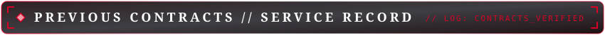

  <!-- HERO BANNER -->
  

    

  <!-- STYLIZED TITLE HEADER -->
  

   

  <!-- DYNAMIC ANIMATED TYPING SUBTITLE (CINZEL FONT) -->
  

    

  <!-- QUICK ACTION BADGES -->
  

    
    
    
    
  

---

<!-- BLOCK 1: HUD STATUS -->
<table width="100%">
<tr>
<td>

  

  

 

</td>
</tr>
</table>

 

<!-- BLOCK 2: ABOUT THE HUNTER -->
<table width="100%">
<tr>
<td>

</td>
</tr>
<tr>
<td>

  <b>◆ [ SPEC 01 ]</b> &nbsp; <strong>SOFTWARE ENGINEER // CROSS-PLATFORM</strong> 
  &nbsp;&nbsp;&nbsp;&nbsp;<em>Flutter &amp; Dart</em> &nbsp;•&nbsp; <code>Mobile &amp; Desktop Architecture</code> &nbsp;•&nbsp; <kbd>CODE SPEC DETAILS</kbd>

  Engineering clean, modular, and reactive cross-platform applications across mobile and desktop platforms utilizing <strong>Flutter &amp; Dart</strong>. Focused on clean architecture, reactive state management, decoupled business logic, and fluid 60fps UI performance.

</td>
</tr>
<tr>
<td>

  <b>◆ [ SPEC 02 ]</b> &nbsp; <strong>HARD-SURFACE 3D ARTIST // GAME-READY</strong> 
  &nbsp;&nbsp;&nbsp;&nbsp;<em>Blender &amp; Substance Painter</em> &nbsp;•&nbsp; <code>PBR Textures &amp; UVs</code> &nbsp;•&nbsp; <kbd>CODE SPEC DETAILS</kbd>

  Modeling optimized, game-ready assets, weapons, props, and mechanical components with clean edge flow, low-poly topology, and precise UV unwrapping in <strong>Blender</strong>. Authoring realistic, weathered PBR texture sets in <strong>Adobe Substance 3D Painter</strong> with clean baking and maximum texel density.

</td>
</tr>
<tr>
<td>

  <b>◆ [ SPEC 03 ]</b> &nbsp; <strong>GAME DEVELOPER // REAL-TIME SYSTEMS</strong> 
  &nbsp;&nbsp;&nbsp;&nbsp;<em>Unity &amp; Godot</em> &nbsp;•&nbsp; <code>Mechanics &amp; Physics Controllers</code> &nbsp;•&nbsp; <kbd>CODE SPEC DETAILS</kbd>

  Actively designing and experimenting with real-time gameplay mechanics, character physics controllers, state machines, and interactive indie prototypes in <strong>Unity</strong> and <strong>Godot</strong>. Focused on responsive controls, component architecture, and engine profiling.

</td>
</tr>
<tr>
<td>

  <b>◆ [ SPEC 04 ]</b> &nbsp; <strong>UI/UX LECTURER // PRODUCT DESIGN</strong> 
  &nbsp;&nbsp;&nbsp;&nbsp;<em>Figma &amp; Design Systems</em> &nbsp;•&nbsp; <code>Heuristics &amp; Mentorship</code> &nbsp;•&nbsp; <kbd>CODE SPEC DETAILS</kbd>

  Teaching human-centered design heuristics, design systems, usability workflows, and rapid interactive prototyping in <strong>Figma</strong>. Mentoring aspiring designers and multimedia students through practical workflows, visual hierarchy principles, and iterative prototype testing.

</td>
</tr>
<tr>
<td>

  <b>◆ [ HUNTER CODE ]</b> &nbsp; <strong>COMBAT PHILOSOPHY // STYLE RANK</strong> 
  &nbsp;&nbsp;&nbsp;&nbsp;<em>Smokin' Sexy Style</em> &nbsp;•&nbsp; <code>Clean Topology &amp; Clean Code</code> &nbsp;•&nbsp; <kbd>CODE SPEC DETAILS</kbd>

  Clean topology in 3D, clean architecture in code, and Smokin' Sexy Style execution everywhere. Zero non-manifold geometry, zero technical debt, and flawless visual presentation across every build.

</td>
</tr>
</table>

 

<!-- BLOCK 3: ARSENAL & WEAPON LOADOUT -->
<table width="100%">
<tr>
<td>

  

<strong>Devil Arms // Engines &amp; Frameworks</strong>

  
  
  

 

<strong>Ebony &amp; Ivory // Core Languages</strong>

  
  
  
  
  

 

<strong>Sparda Relics // Hard-Surface 3D &amp; UI/UX</strong>

  
  
  

 

<strong>Workshop // Developer Tools</strong>

  
  
  
  
  

 

</td>
</tr>
</table>

 

<!-- BLOCK 4: PREVIOUS CONTRACTS // SERVICE RECORD -->
<table width="100%">
<tr>
<td>

</td>
</tr>
<tr>
<td>

  <b>◆ [ CONTRACT 01 ]</b> &nbsp; <strong>LECTURER: UI/UX &amp; WEB DESIGN</strong> 
  &nbsp;&nbsp;&nbsp;&nbsp;<em>Al-Ghad International College</em> &nbsp;•&nbsp; <code>Jun 2026 – Present</code> &nbsp;•&nbsp; <kbd>MISSION BRIEF ▼</kbd>

 

  <strong>Institution:</strong> Al-Ghad International College 
  <strong>Role &amp; Duration:</strong> Lecturer: UI/UX &amp; Web Design (Jun 2026 – Present) 
  <strong>Department:</strong> Graphic Design Department (2nd &amp; 4th Year Cohorts) 
  <strong>Discipline:</strong> Digital Product Design, Web UX Architecture &amp; Visual Hierarchy 
  <strong>Tools &amp; Weapons:</strong> Figma, Design Systems, Responsive Layouts, Heuristics

<strong>Mission Scope &amp; Deliverables:</strong>

<ul>
  <li>Instructing 2nd- and 4th-year Graphic Design undergraduate cohorts in Web Design architecture, user experience fundamentals, and interactive prototyping utilizing Figma.</li>
  <li>Teaching core design concepts, visual hierarchy principles, layout balance, and practical techniques for directing user attention across digital interfaces.</li>
</ul>

</td>
</tr>
<tr>
<td>

  <b>◆ [ CONTRACT 02 ]</b> &nbsp; <strong>WORKSHOP INSTRUCTOR: GRAPHIC DESIGN</strong> 
  &nbsp;&nbsp;&nbsp;&nbsp;<em>Saba University</em> &nbsp;•&nbsp; <code>May 2026</code> &nbsp;•&nbsp; <kbd>MISSION BRIEF ▼</kbd>

 

  <strong>Organization:</strong> Saba University 
  <strong>Contract Duration:</strong> May 2026 (5-Day Intensive Workshop) 
  <strong>Discipline:</strong> Game Art Pipeline &amp; Cinematic Presentation 
  <strong>Tools &amp; Weapons:</strong> 2D/3D Asset Creation, Lighting, Design Psychology

<strong>Mission Scope &amp; Deliverables:</strong>

<ul>
  <li>Led an intensive 5-day workshop guiding students through the complete game art pipeline, from graphic design psychology to final presentation.</li>
  <li>Mentored students in translating conceptual design principles into functional game-ready 3D assets, topology considerations, and UV workflows.</li>
  <li>Taught real-time lighting setup, composition theory, and cinematic presentation workflows for interactive media.</li>
</ul>

</td>
</tr>
<tr>
<td>

  <b>◆ [ CONTRACT 03 ]</b> &nbsp; <strong>GAME DEV INSTRUCTOR &amp; TECHNICAL SUPERVISOR</strong> 
  &nbsp;&nbsp;&nbsp;&nbsp;<em>Leapat (Hadhramout Foundation)</em> &nbsp;•&nbsp; <code>Jan 2026 – Mar 2026</code> &nbsp;•&nbsp; <kbd>MISSION BRIEF ▼</kbd>

 

  <strong>Organization:</strong> Leapat (in partnership with Hadhramout Foundation) 
  <strong>Role &amp; Duration:</strong> Game Development Instructor &amp; Technical Supervisor (Jan 2026 – Mar 2026) 
  <strong>Discipline:</strong> Game Engine Architecture &amp; Production Mentorship 
  <strong>Tools &amp; Weapons:</strong> Unity Engine, C# Mechanics, Performance Profiling, Agile

<strong>Mission Scope &amp; Deliverables:</strong>

<ul>
  <li>Directed an intensive game development initiative, commencing with a focused 1-week Unity and C# bootcamp and transitioning into a 3-month hands-on practical supervision phase.</li>
  <li>Mentored trainees through complex technical troubleshooting, gameplay programming, scene architecture, and collaborative studio standards.</li>
  <li>Conducted comprehensive milestone and sprint reviews, ensuring student prototypes adhered to strict real-time performance budgets, frame rates, and agile delivery methodologies.</li>
</ul>

</td>
</tr>
<tr>
<td>

  <b>◆ [ CONTRACT 04 ]</b> &nbsp; <strong>LEAD 3D ARTIST</strong> 
  &nbsp;&nbsp;&nbsp;&nbsp;<em>Nerdmagic Studios</em> &nbsp;•&nbsp; <code>Aug 2025 – Jan 2026</code> &nbsp;•&nbsp; <kbd>MISSION BRIEF ▼</kbd>

 

  <strong>Studio:</strong> Nerdmagic Studios 
  <strong>Role &amp; Duration:</strong> Lead 3D Artist (Aug 2025 – Jan 2026) 
  <strong>Discipline:</strong> Hard-Surface 3D Modeling &amp; PBR Texturing 
  <strong>Tools &amp; Weapons:</strong> Blender, Adobe Substance 3D Painter, Unity, Modular Kits, UV Optimization

<strong>Mission Scope &amp; Deliverables:</strong>

<ul>
  <li>Directed the overall visual style for a newly founded studio, establishing strict artistic guidelines, visual fidelity benchmarks, and seamless cross-discipline collaboration.</li>
  <li>Managed the complete end-to-end 3D pipeline—from hard-surface modeling, low-poly topology, and high-to-low baking to PBR texturing, rigging, and in-engine optimization.</li>
  <li>Architected and implemented modular environment kits and efficient UV mapping pipelines, drastically accelerating the studio's level design throughput.</li>
</ul>

</td>
</tr>
<tr>
<td>

  <b>◆ [ CONTRACT 05 ]</b> &nbsp; <strong>UNIVERSITY LECTURER: GAME DESIGN</strong> 
  &nbsp;&nbsp;&nbsp;&nbsp;<em>Knowledge &amp; Modern Sciences University</em> &nbsp;•&nbsp; <code>2024 – 2025</code> &nbsp;•&nbsp; <kbd>MISSION BRIEF ▼</kbd>

 

  <strong>Institution:</strong> Knowledge and Modern Sciences University (KMSU) 
  <strong>Department &amp; Courses:</strong> Multimedia Dept • Game-Design-1 &amp; Game-Design-2 
  <strong>Timeline:</strong> 2024 – 2025 
  <strong>Discipline:</strong> Real-Time Game Architecture &amp; Interactive Systems 
  <strong>Tools &amp; Weapons:</strong> Unity Game Engine, C# Scripting, Physics Controllers

<strong>Mission Scope &amp; Deliverables:</strong>

<ul>
  <li>Lectured two core university courses (Game-Design-1 and Game-Design-2) in the Multimedia Department, educating students in game development fundamentals.</li>
  <li>Instructed game mechanics programming, state machine logic, physics controllers, and scene architecture using the Unity Game Engine.</li>
  <li>Designed practical assignments, examinations, and milestone projects that guided students to iterate from concepts to fully playable games.</li>
  <li>Evaluated comprehensive capstone projects, simulating professional studio feedback loops to prepare students for commercial game development pipelines.</li>
</ul>

</td>
</tr>
<tr>
<td>

  <b>◆ [ CONTRACT 06 ]</b> &nbsp; <strong>ASSISTANT LECTURER: GAME DEV &amp; 3D MODELING</strong> 
  &nbsp;&nbsp;&nbsp;&nbsp;<em>Twintech University</em> &nbsp;•&nbsp; <code>Dec 2023 – Jan 2025</code> &nbsp;•&nbsp; <kbd>MISSION BRIEF ▼</kbd>

 

  <strong>Institution:</strong> International University of Science Twintech (IUST) 
  <strong>Role &amp; Duration:</strong> Assistant Lecturer: Game Development &amp; 3D Modeling (Dec 2023 – Jan 2025) 
  <strong>Discipline:</strong> 3D Production Pipelines &amp; Gameplay Scripting 
  <strong>Tools &amp; Weapons:</strong> Blender 3D, Unity Engine, C# Mechanics, Physics Scripting

<strong>Mission Scope &amp; Deliverables:</strong>

<ul>
  <li>Delivered comprehensive university coursework across both Blender 3D (hard-surface modeling, UV unwrapping, texturing, animation pipelines) and the Unity Engine.</li>
  <li>Taught C# gameplay mechanics, physics controllers, collision systems, camera scripting, and runtime performance optimization.</li>
  <li>Guided students through real-time asset export pipelines from Blender into Unity, emphasizing topology cleanliness and engine performance.</li>
</ul>

</td>
</tr>
</table>

 

<!-- BLOCK 5: HARD-SURFACE VAULT & MISSIONS -->
<table width="100%">
<tr>
<td>

  

  

    
  

  

    <strong>Game-Ready Hard-Surface Assets</strong> 
    Low-poly optimized topology, clean UV unwrapping, and realistic PBR texturing for game engines. Showcasing mechanical models and props.
     
    <a href="https://www.artstation.com/omarsami">👉 View ArtStation Gallery</a>
  

  

  

    
  

  

    <strong>Gameplay Mechanics &amp; Prototypes</strong> 
    Action-oriented gameplay mechanics, character state machines, and real-time interactive prototypes in Godot and Unity.
     
    <em>Check out the pinned repositories below!</em>
  

 

</td>
</tr>
</table>

 

<!-- BLOCK 6: COMBAT STATISTICS -->
<table width="100%">
<tr>
<td>

  

  

    
    
  

  

    
  

 

</td>
</tr>
</table>

 

<!-- BLOCK 7: TRANSMISSION FREQUENCIES -->
<table width="100%">
<tr>
<td>

  

  

    
    
    
  

   

  

    ⚡ <em>"Jackpot!"</em> ⚡
  

 

</td>
</tr>
</table>
